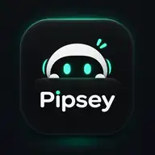

<div align="center">



# Pipsey

### Show it. Understand it. Build it.

**A tiny AI desktop companion that watches a software interaction you demonstrate and explains how it works.**

[](#project-status) [](#platform) [](LICENSE)

*An independent, open-source project inspired by [HeyClicky](https://www.heyclicky.com/). Not affiliated with HeyClicky or its creator.*

</div>

---

## ✨ Meet Pipsey

See an interaction you love? Instead of guessing how it was built, **show Pipsey**.

1. **Summon.** Press **Option + Command** (intended shortcut; feasibility is a first-milestone test).
2. **Ask.** “Hey Pipsey, can you explain how this works?”
3. **Show.** Hover, click, open, drag, or trigger the interaction in another app.
4. **Finish.** Stop the visibly indicated recording.
5. **Understand.** Pipsey explains what changed, what likely caused it, and a plausible way to build it.
6. **Follow up.** Ask “How would I implement that in React?” without recording again.

> **Feature Mode is the MVP.** Pipsey observes user-initiated demonstrations; it does not autonomously operate your computer or claim to see unrecorded actions.

## 🎯 What makes it different?

Pipsey is about **software behavior, not screenshots**. It tries to explain the transition between UI states, what triggers them, and implementation patterns. It distinguishes **observations** (shown in a captured frame) from **hypotheses** (the private code or framework an app might use). It is not a feature-for-feature HeyClicky clone.

## 🧠 How Pipsey works

```text
   Top-center Mac companion (SwiftUI + AppKit)
                │
      Shortcut → record → stop
                │
     ┌──────────┴────────────┐
     │                       │
 ScreenCaptureKit       Speech transcription
 frames + cursor        question + timestamps
     │                       │
     ▼                       │
 Small hosted VLM            │
 timestamped observations   │
     └──────────┬────────────┘
                ▼
       Evidence-based timeline
                ▼
      Conversational text LLM
                ▼
   Streaming explanation + voice
                ▼
          Follow-up chat
```

**Two models, separate jobs:** the small VLM observes visual changes; the text LLM reasons with the question and verified evidence. Speech recognition and synthesis are supporting subsystems. No fake “I saw that” commentary while analysis is pending.

## 🧩 MVP scope

| Included in the first usable release | Deliberately later |
| --- | --- |
| Native macOS menu-bar / top-center companion | Autonomous clicking and typing |
| Clear start, stop and cancel controls | Debug Mode |
| Explicit screen and microphone permissions | Full-screen continuous surveillance |
| Short, bounded recording + timestamped context | Automatic codebase generation |
| Small hosted VLM + independent text LLM | Large memory / agent frameworks |
| Grounded explanation + follow-up conversation | Windows support |
| Natural, truthful progress + optional spoken response | 3D diagrams and complex drawing |

## 🚦 Project status

**M0 Verified / M1 Companion Shell in progress.** The repository contains an active Swift package architecture (`PipseyCore`, `Pipsey`, and `PipseyTests`) verified on Apple Silicon M1 (macOS 27.2 / Swift 6.3.3) with 28/28 passing tests. Native non-activating floating island panel and menu bar integration are functional. Capture pipeline (M2) and model adapters (M3/M4) are next. All updates are logged with empirical evidence in [PROGRESS.md](PROGRESS.md).

**Start here:**

| Read | Purpose |
| --- | --- |
| [AGENTS.md](AGENTS.md) | Canonical autonomous-agent operating contract |
| [PRODUCT.md](PRODUCT.md) | User journey, feature boundaries, UX states |
| [ARCHITECTURE.md](ARCHITECTURE.md) | Components, data flow, capture and inference |
| [API_CONTRACTS.md](API_CONTRACTS.md) | Evidence envelope and provider interfaces |
| [IMPLEMENTATION_PLAN.md](IMPLEMENTATION_PLAN.md) | Milestones, order, quality gates |
| [CHECKPOINTS.md](CHECKPOINTS.md) | Durable checklist / handoff ledger |
| [EVALUATION.md](EVALUATION.md) | Scenarios, metrics, acceptance thresholds |
| [SECURITY.md](SECURITY.md) | Screen/audio privacy, permissions, threat model |
| [DEVELOPMENT.md](DEVELOPMENT.md) | Environment and future build commands |
| [DECISIONS.md](DECISIONS.md) | Locked decisions vs unvalidated hypotheses |
| [PROGRESS.md](PROGRESS.md) | Progress, blockers, test results, next actions |

## 💻 Platform

Designed first for **Apple Silicon macOS**, starting with an **M1 MacBook Air**. On machines without a hardware notch, Pipsey uses a top-center *island-style* panel. Exact minimum macOS / Xcode versions are to be established by compatibility testing, not invented in this README.

## 🔐 Local setup (when implementation begins)

Copy **.env.example** to a local **.env**, configure approved provider URLs/model IDs, and store real API credentials in **macOS Keychain** in the app. Never commit .env or raw captured sessions. The current repository is a *blueprint*, so there is no runnable setup command yet. See [DEVELOPMENT.md](DEVELOPMENT.md).

## 🌱 Open source

MIT-licensed repository code unless a future file states otherwise. Third-party licensed code/assets retain their own terms. [CONTRIBUTING.md](CONTRIBUTING.md) describes how to contribute. This project credits HeyClicky as inspiration; it is a separate implementation.

<div align="center"><sub>Built out of curiosity. Designed to make software a little less mysterious.</sub></div>
