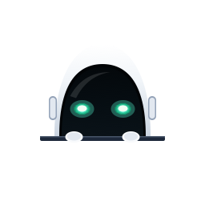

<div align="center">


# Pipsey

### Show it. Understand it. Build it.

**A native macOS AI companion that watches a software interaction you demonstrate and explains how it works.**

[](#project-status) [](#project-status) [](#platform) [](LICENSE)

<p align="center">
  <b>Made with ❤️ by Devayush</b>
</p>

*An independent, open-source project inspired by [HeyClicky](https://www.heyclicky.com/), [boring.notch](https://github.com/TheBoredTeam/boring.notch), and [clicky](https://github.com/farzaa/clicky). Not affiliated with HeyClicky or its creator.*

</div>

---

## ✨ Meet Pipsey

See an interaction you love? Instead of guessing how it was built, **show Pipsey**.

1. **Summon.** Press **Option + Command** (intended shortcut; feasibility is a first-milestone test).
2. **Ask.** “Hey Pipsey, can you explain how this works?”
3. **Show.** Hover, click, open, drag, or trigger the interaction in another app.
4. **Finish.** Stop the visibly indicated recording.
5. **Understand.** Pipsey explains what changed, what likely caused it, and a plausible way to build it.
6. **Follow up.** Ask “How would I implement that in React?” without recording again.

> **Feature Mode is the MVP.** Pipsey observes user-initiated demonstrations; it does not autonomously operate your computer or claim to see unrecorded actions.

## 🎯 What makes it different?

Pipsey is about **software behavior, not screenshots**. It tries to explain the transition between UI states, what triggers them, and implementation patterns. It distinguishes **observations** (shown in a captured frame) from **hypotheses** (the private code or framework an app might use). It is not a feature-for-feature HeyClicky clone.

## 🧠 How Pipsey works

```text
   Top-center Mac companion (SwiftUI + AppKit)
                │
      Shortcut → record → stop
                │
     ┌──────────┴────────────┐
     │                       │
 ScreenCaptureKit       Speech transcription
 frames + cursor        question + timestamps
     │                       │
     ▼                       │
 Small hosted VLM            │
 timestamped observations   │
     └──────────┬────────────┘
                ▼
       Evidence-based timeline
                ▼
      Conversational text LLM
                ▼
   Streaming explanation + voice
                ▼
          Follow-up chat
```

**Two models, separate jobs:** the small VLM observes visual changes; the text LLM reasons with the question and verified evidence. Speech recognition and synthesis are supporting subsystems. No fake “I saw that” commentary while analysis is pending.

## 🧩 MVP scope

| Included in the first usable release | Deliberately later |
| --- | --- |
| Native macOS menu-bar / top-center companion | Autonomous clicking and typing |
| Clear start, stop and cancel controls | Debug Mode |
| Explicit screen and microphone permissions | Full-screen continuous surveillance |
| Short, bounded recording + timestamped context | Automatic codebase generation |
| Small hosted VLM + independent text LLM | Large memory / agent frameworks |
| Grounded explanation + follow-up conversation | Windows support |
| Natural, truthful progress + optional spoken response | 3D diagrams and complex drawing |

## 🚦 Project status

**Native macOS Application Fully Operational (Feature Mode MVP Verified).** Pipsey is a working native macOS companion built with Swift 6, SwiftUI, AppKit, ScreenCaptureKit, and CoreImage. It features:
- **Top-Center Bezel-Anchored Notch:** Anchored flush at `Y = 0` (`.mainMenu + 3` layer) matching physical MacBook notch geometry and non-notched M1 displays with smooth spring animations.
- **Pure Mascot Visual Identity:** High-resolution native vector robot mascot system (app icon, notch peeking avatar, status item template icon) free of embedded text.
- **Operational ScreenCaptureKit Stream:** Live `SCStream` capturing real display buffers with hardware-accelerated `CIContext` JPEG encoding, adaptive 2 fps frame sampling with SHA256 deduplication, and burst-capture on pointer interactions.
- **Passive Mouse Event Recording:** Zero-keystroke pointer tracking capturing mouse clicks and rate-limited cursor movements to ground visual observations.
- **Audio Capture & Reactive Waveform:** Live RMS audio power metering with 5-bar reactive audio waveform and tactile native audio feedback.
- **Two-Model AI Pipeline:** Remotely hosted small VLM observer (`HostedVLMClient`) analyzing real screen frames, validated against schema and timestamp bounds (`ObservationValidator`), coupled with an independent conversational LLM (`HostedConversationClient`) for code-level explanations and follow-ups.
- **BYOK & macOS Keychain Storage:** In-app Settings sheet with Keychain credential storage (`kSecClassGenericPassword`), live connection testing, and support for OpenAI-compatible and Anthropic endpoints.
- **274+ Automated Tests:** 274 passing offline unit, contract, and adversarial hallucination defense tests (277 total including live two-model network suites).

## 📚 Documentation

Detailed architectural, technical, and engineering specifications are located in the [`docs/`](docs/) directory:

- [**Architecture & Call Graph**](docs/ARCHITECTURE.md) — Two-model architecture, ScreenCaptureKit pipeline, and non-activating UI lifecycle.
- [**API Contracts & Schemas**](docs/API_CONTRACTS.md) — Strict JSON schemas for evidence manifests, VLM observations, and LLM responses.
- [**Product Requirements (PRD)**](docs/PRODUCT.md) — Feature Mode specifications, user journeys, and scope boundaries.
- [**Engineering Progress Ledger**](docs/PROGRESS.md) — Empirical test logs, benchmark latencies, and implementation history.
- [**Milestone Checkpoints**](docs/CHECKPOINTS.md) — Authoritative verification matrix across M0–M5 milestones.
- [**Security & TCC Permissions**](docs/SECURITY.md) — macOS sandbox, Keychain BYOK credential management, and privacy model.
- [**Local Development Guide**](docs/DEVELOPMENT.md) — Environment setup, code standards, and build tooling.
- [**VLM Evaluation Protocol**](docs/EVALUATION.md) — Canonical UI transition benchmark suite (E01–E10).
- [**Architecture Decisions (ADRs)**](docs/DECISIONS.md) — Key technical decisions and rationale.
- [**Brand & Mascot Design**](docs/BRAND.md) — Visual identity and vector asset specifications.

## 🚀 Quickstart & Installation

### Prerequisites
- macOS 13.0+ on Apple Silicon (M1/M2/M3/M4) or Intel.
- Swift 6.0+ toolchain (Xcode or Apple Command Line Tools).

### 1. Build and Run Directly
```bash
# Clone the repository
git clone https://github.com/ayushcodes13/Pipsey.git
cd Pipsey

# Run test verification suite (274 tests)
swift run PipseyTests

# Run Pipsey in debug mode
swift run Pipsey
```

### 2. Package Native .app Bundle
```bash
# Build native Pipsey.app bundle
./scripts/build-app.sh

# Launch application
open build/Pipsey.app
```

Press **⌥⌘P** (Option + Command + P) anywhere on your Mac or click the robot in the menu bar / notch to activate Pipsey! Provide your API keys via **Settings & AI Keys...** in the menu bar or notch gear icon.

## 🔐 Privacy & Keychain Credentials

Pipsey stores your API keys securely in the macOS Keychain (`kSecClassGenericPassword`). Captures are strictly bounded, never run in the background, and all temporary frames in `/tmp/pipsey-session-*` are immediately purged upon session cancellation or reset. Copy `.env.example` to `.env` only for experimental endpoints.

## 🌱 Open source

MIT-licensed repository code unless a future file states otherwise. Third-party licensed code/assets retain their own terms. [CONTRIBUTING.md](CONTRIBUTING.md) describes how to contribute. This project credits HeyClicky as inspiration; it is a separate implementation.

<div align="center"><sub>Made with ❤️ by Devayush. Built out of curiosity to make software a little less mysterious.</sub></div>
